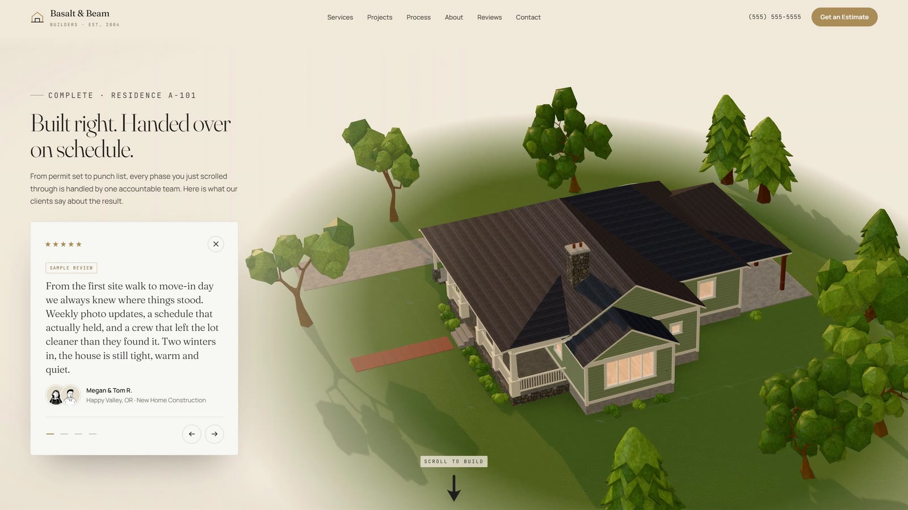

# Basalt & Beam Builders — website concept

A scroll-driven 3D website for a fictional Pacific Northwest home builder. The hero blueprint draws itself on load,
then, as you scroll, Residence A-101 is built phase by phase: plans, foundation, framing, interiors, windows,
kitchen and bath, roof and landscaping. Everything is real-time WebGL, not a video.

**Live site:** https://jeremy-mironov.github.io/basalt-and-beam/



## Built with

- One static `index.html` with no build step: HTML, CSS and JavaScript modules
- [Three.js](https://threejs.org) r169 for the house, the blueprint linework and the landscape (glTF + Draco, instanced trees)
- [GSAP ScrollTrigger](https://gsap.com/docs/v3/Plugins/ScrollTrigger/) and [Lenis](https://lenis.darkroom.engineering) for the scroll choreography
- Furniture, trees and materials prepared in Blender, decimated and baked into texture atlases
- Fraunces, Manrope and JetBrains Mono from Google Fonts
- A reduced-motion fallback, keyboard focus states and a responsive layout from 360 px up

## Run locally

Any static server works, for example:

```bash
npx serve .
```

## About the content

This is a design concept. The company, address, (555) phone number, licence numbers, ratings and reviews are
placeholders (each review is marked "Sample review"), and the page asks search engines not to index it.

## Credits

- Photos: Unsplash, see [images/CREDITS.md](images/CREDITS.md)
- 3D models and materials: BlenderKit (CC0 and Royalty Free), see [assets/CREDITS.md](assets/CREDITS.md). They are
  included only as part of this site and are not licensed for reuse from this repository.
- Review avatars: DiceBear "Notionists" by Zoish (CC0)
